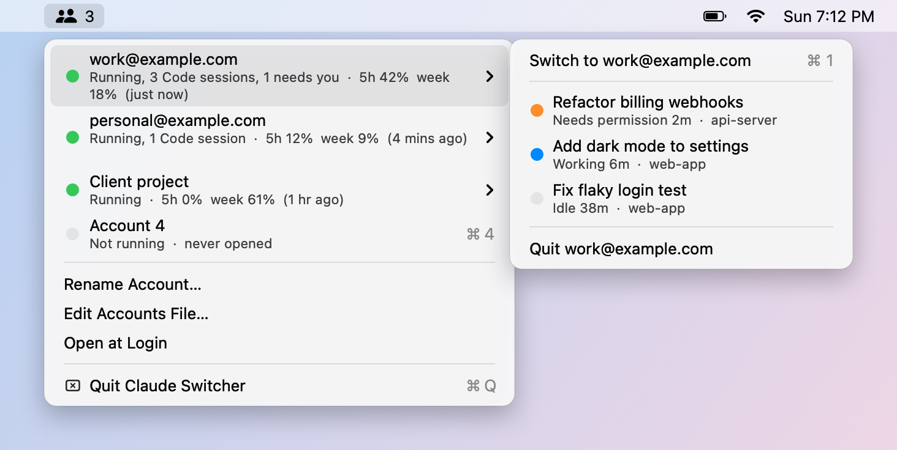

# Claude Switcher

A tiny macOS menu bar app for running several Claude desktop accounts side by side, with each account's usage and live Claude Code session status one hover away.

<picture>
  <source media="(prefers-color-scheme: dark)" srcset="docs/menu-dark.png">
  
</picture>

## What it does

- **One Claude window per account.** Each account runs as its own copy of the Claude desktop app with its own login, chats and settings, so a work and a personal account can be open at the same time.
- **Switch with one shortcut.** Pick an account from the menu, or press ⌘1–⌘9 while the menu is open. A running account comes to the front; a stopped one launches.
- **Usage at a glance.** Each account shows its 5-hour and weekly plan usage, as last recorded by the Claude app.
- **Live Code session status.** Hover a running account to see its Claude Code sessions and what each one is doing, so you can tell which one is waiting on you without opening every window.

| Dot | Meaning |
| --- | --- |
| 🟢 green (account) | That account's Claude app is running |
| 🟠 orange (session) | **Needs permission** or **Needs input**: the session is waiting on you |
| 🔵 blue (session) | **Working** on a turn |
| ⚪ gray | Account not running, or session **Idle** (finished its turn) |

Times next to a session show how long it has been in that state, for example `Idle 38m`. Waiting sessions are listed first.

## Requirements

- macOS 14.4 (Sonoma) or later
- [Claude for Mac](https://claude.ai/download) installed at `/Applications/Claude.app`
- Xcode Command Line Tools, for `swiftc`. Install them with `xcode-select --install` if you don't have them.

## Install

```bash
git clone https://github.com/mueedqadri/claude-switcher.git
cd claude-switcher
./build.sh
open ~/Applications/"Claude Switcher.app"
```

`build.sh` compiles `main.swift`, wraps it in an app bundle in `~/Applications`, and signs it locally. There's nothing to download and no Xcode project. To update, `git pull` and run `./build.sh` again, then quit and reopen the app.

To start it automatically, choose **Open at Login** from its menu.

## Set up your accounts

The first launch creates `~/Library/Application Support/ClaudeSwitcher/accounts.json` with five slots:

| Menu name | Claude profile folder in `~/Library/Application Support/` |
| --- | --- |
| Account 1 | `Claude` (your normal Claude app login) |
| Account 2 | `Claude-Desktop` |
| Account 3 | `Claude-Desktop-2` |
| Account 4 | `Claude-Desktop-3` |
| Account 5 | `Claude-Desktop-4` |

1. Click **Account 2**. A fresh Claude window opens with its own empty profile.
2. Sign in with your second account. That profile remembers the login from now on.
3. Repeat for any other slots you want. Slots you never open just say "never opened".

**Names.** If the same account is also signed in to the Claude Code CLI on this Mac, the menu shows its email automatically. Otherwise, use **Rename Account…** to call it something like "Work" or "Personal".

**More or fewer accounts.** Choose **Edit Accounts File…** and add or remove entries. Each entry is a display name plus a folder name, and any new folder name becomes a new, empty profile:

```json
[
  { "name": "Account 1", "folder": "Claude" },
  { "name": "Work", "folder": "Claude-Desktop" },
  { "name": "Side project", "folder": "Claude-Desktop-Side" }
]
```

## Using the menu

- **Account not running:** click it (or press its ⌘ number) to launch it.
- **Account running:** hover it to open its submenu:
  - **Switch to …** brings that account's window to the front. ⌘1–⌘9 trigger this directly.
  - Each **Code session** row shows the session title, its status and the project folder. Clicking one brings the account forward.
  - **Quit …** quits just that account's Claude app.
- The menu bar icon shows how many accounts are running.

For a quick look from Terminal, `--dump` prints the same information:

```bash
~/Applications/"Claude Switcher.app"/Contents/MacOS/ClaudeSwitcher --dump
```

## Optional: start every 5-hour window early

Claude's 5-hour usage window starts with your first message. `ping-haiku.sh` sends one tiny Haiku message from each Claude Code CLI login, so each window is already running by the time you sit down. `install-ping.sh` runs it at login and then every 5 hours and 1 minute via `launchd`.

It uses Claude Code CLI logins, not the desktop app profiles:

- your default login (`~/.claude.json`)
- every `~/.claude-*/` folder that has a login. Create one with `CLAUDE_CONFIG_DIR=~/.claude-work claude`, then run `/login`.

```bash
./install-ping.sh               # install and run once now
./install-ping.sh --uninstall   # remove it
```

Each ping uses a very small amount of your plan. Results are logged to `~/Library/Logs/ClaudeSwitcher-ping.log`.

## How it works

Everything is local. The app makes no network requests and never changes Claude's own files; it only writes its `accounts.json`.

- **Separate accounts** come from launching Claude with `open -n -a Claude --args --user-data-dir=<profile folder>`, which gives each copy its own login and data.
- **Running state** comes from `ps`, matching each Claude process to its profile folder.
- **Usage** is the last sample in each profile's `plan-usage-history.json`. The Claude app updates it only while that account is running, so the menu shows how old the sample is.
- **Session status** comes from `~/.claude/sessions/<pid>.json`, which every running Claude Code process keeps up to date (`busy`, `waiting` or `idle`).
- **Emails** come from the Claude Code CLI's `~/.claude.json` and `~/.claude-*/.claude.json`, matched against each profile's account ID.

These are internal details of the Claude apps, not public APIs, so a Claude update can change them. When that happens the affected part degrades: sessions fall back to a plain "Code session" row and usage disappears, but switching keeps working.

## Troubleshooting

- **An account shows "Account 2" instead of an email.** Email detection needs that account to be signed in to the Claude Code CLI too. Use **Rename Account…** instead.
- **Usage numbers look old.** They only refresh while that account's Claude app is running; the age is shown in brackets.
- **A session is missing from the submenu.** Only sessions with a running Claude Code process appear. A session you haven't opened since Claude restarted has no process yet, so it shows up once you open it.
- **Open at Login fails.** Make sure you launched the copy in `~/Applications` that `build.sh` installed.

## Uninstall

Turn off **Open at Login** in its menu and quit it, then:

```bash
./install-ping.sh --uninstall
rm -rf ~/Applications/"Claude Switcher.app" ~/Library/Application\ Support/ClaudeSwitcher
```

The account profile folders (`~/Library/Application Support/Claude-Desktop*`) hold each extra account's login and local data; delete them only if you want those accounts gone from this Mac. Never delete the plain `Claude` folder: that's the Claude app's own profile.

## Contributing

Issues and pull requests are welcome. See [AGENTS.md](AGENTS.md) for how the code is laid out and how to check changes; it's written for coding agents but works just as well for people.

Claude Switcher is an independent project, not made by or affiliated with Anthropic.

## License

[MIT](LICENSE)
